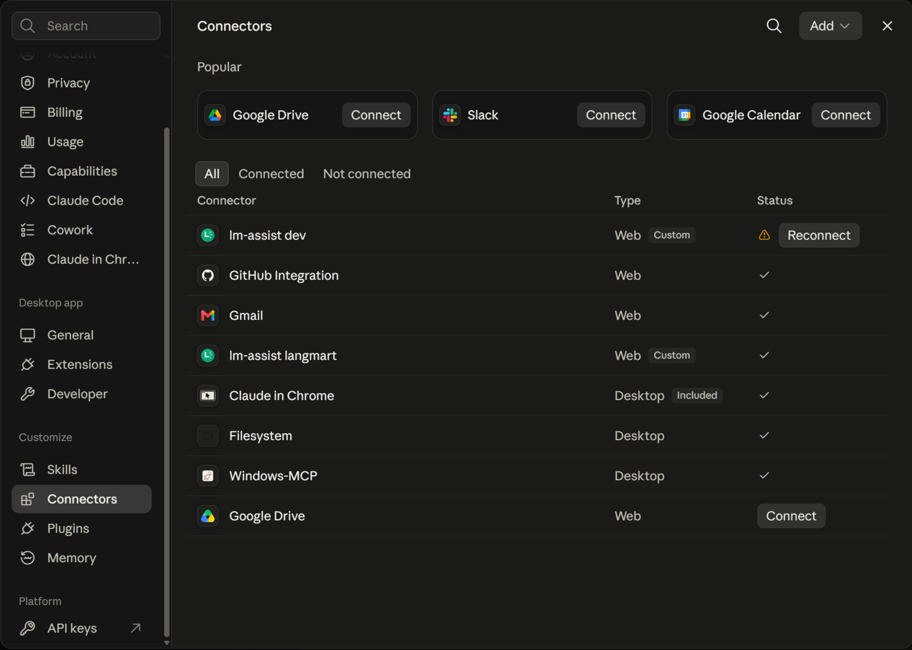
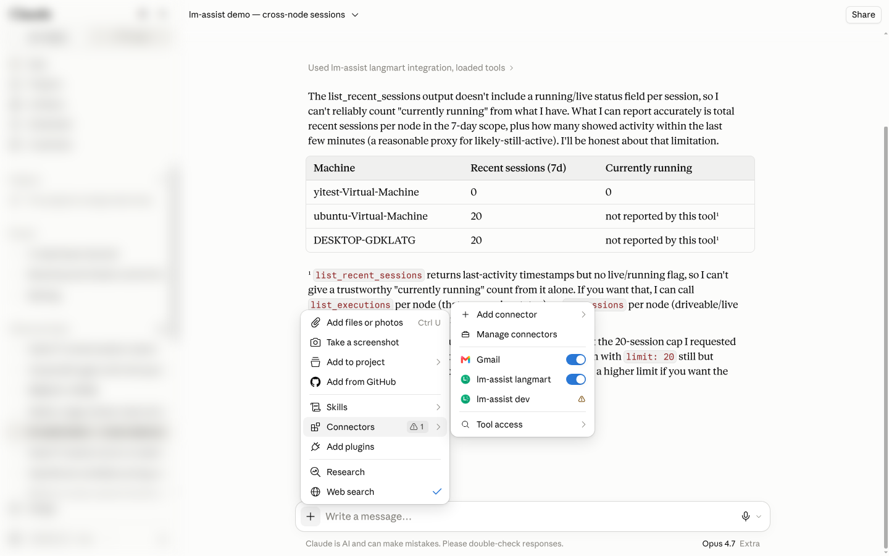
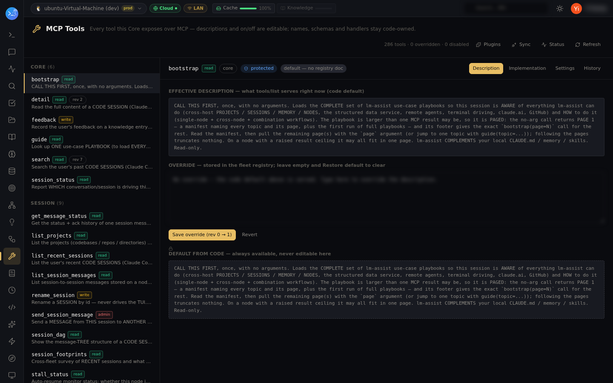

# The MCP connector — how Claude reaches lm-assist

> The main door. This page explains what the connector is, how you add it (Claude Code gets it
> when a node enrolls; a claude.ai account adds it once), why a relay sits in the middle, how to
> hold one connector per tool loading profile, and how the 280+ tools are governed. Usage
> examples live in [`examples/mcp-connector-install`](../examples/mcp-connector-install/).

## What you see

In the Claude desktop app (and at claude.ai → Settings → Connectors) the connector shows up as
**lm-assist langmart**, type *Web · Custom*, with a green check once connected:



Inside any conversation, the composer's **+ → Connectors** submenu lists it with an on/off
toggle and a *Tool access* entry for per-tool approval:



When it fires, the conversation shows *"Used lm-assist langmart integration"* above the reply
— see the real bootstrap-and-cross-node-sessions run in the
[connector example](../examples/mcp-connector-install/).

## Why there is a relay

Claude — whether that's claude.ai in a browser tab, a Cowork session, or the Claude desktop app —
runs in Anthropic's cloud, and an MCP connector must be an **HTTPS endpoint it can reach**. Your
machines are the opposite: behind NAT, on laptops that sleep, with no inbound ports. The hub
closes that gap:

```
claude.ai / Cowork / Claude app
        │  Streamable HTTP  POST https://mcp.<hub-domain>/mcp   (OAuth-bound connector)
        ▼
   LangMart Hub  ──── relays each MCP call over the node's own outbound WebSocket ────▶  node Core (:3100)
        ▲                                                                                     │
        └──────────────── result + provenance footer ⟦lm-assist@hub · node · cluster⟧ ◀──────┘
```

- Each node keeps **one outbound WebSocket** to the hub (`lm-assist login` / `setup --key`);
  nothing listens for inbound traffic on your machines.
- The hub serves the public MCP endpoint, derived from your hub URL
  (`wss://assist-api.<domain>` → `https://mcp.<domain>/mcp`), authenticates the caller, and
  forwards the call to the node the request names (or your default node). Cross-node reach —
  a claude.ai chat reading a session on your Windows box and driving a terminal on your Linux
  server — is this relay doing its job.
- **Claude Code on the same machine doesn't need the relay**: the plugin spawns the MCP server
  over **stdio** and talks to the local Core directly. (The `lm-assist-hub` entry that
  `lm-assist login` writes goes through the hub, like claude.ai does.) Both transports expose
  the same server, the same tool registry, and the same
  [tool loading profiles](#one-connector-per-profile).

## Adding the connector

**Claude Code: written when the node enrolls.** `lm-assist login <keypack>` writes an HTTP MCP
server named `lm-assist-hub` into `~/.claude.json` (user scope; the file is kept owner-only):
URL `https://mcp.<domain>/mcp`, authenticated with the node's own hub key as a Bearer token, so
every new Claude Code session on that machine carries the tools with no OAuth step. `--no-mcp`
opts out. The entry goes through the hub, so the node that answers is your most recently
connected one unless a call names another. For a narrower entry next to it, see
[One connector per profile](#one-connector-per-profile).

**claude.ai, Cowork and the Claude app: added once per account.** Connecting a node to the hub
adds nothing to your claude.ai account, and nothing creates this connector for you. Add it once,
and every Claude surface signed in to that account shows it:

- **By hand.** This works for any connector, including the plain one: *Add custom connector*
  under **Connectors** in claude.ai, with `https://mcp.<domain>/mcp` (or a profile URL, below).
  `POST /claude-ai/mcp/servers {url, name}` on the node does the same thing.
- **From lm-assist.** This creates the connector for a profile. Use *Create* on that profile's
  row of the MCP Tools page (*Profile → Connectors*), or call `mcp_connectors` with action
  `create` and the profile from a session that already has lm-assist, or send
  `POST /mcp/profile-connectors {"profile": "<name>"}`. The node needs a claude.ai
  browser session for this ([how to give it one](../examples/claudeai-browser-auth/)). Creating
  is idempotent by URL: asking twice returns the connector that already exists.

A new connector exists but cannot be used yet. **Connect** is one browser step per connector:
open the connector under Connectors, click *Connect*, and approve the hub's authorization page.
claude.ai creates the OAuth `state` inside its own page and checks it on the callback, so no
server can finish this step for you, lm-assist included. Add connectors one at a time. Each
Connect registers a client with the hub, and when two registrations run at once, one of them can
be lost. The lost one fails later with an unknown `client_id`.

Once a connector is connected, lm-assist keeps it up to date when the node holds a claude.ai
browser session:

1. **Status.** The MCP Tools page's *Profile → Connectors* table lists every claude.ai
   connector whose URL points at this node's hub: one row per profile, plus the unpinned one,
   plus any connector pinned to a profile this node does not know (it is served the node
   default, and the row says so). Each row shows the connection state and tool count, read from
   `/mcp/profile-connectors`, and how many duplicates share its URL. Each profile row has a
   *Delete* action, which removes every connector on that URL; the unpinned row has none.
2. **Upkeep as tools change.** When a plugin adds or removes tools, the node:
   - clears claude.ai's cached tool list on every lm-assist connector for this hub whose
     profile lists a changed tool (a `basic` connector is left alone when a plugin changes);
   - forces the bootstrap refetch;
   - turns on account-level tool access and auto-approval for the new tools, on each connector
     only for the tools that connector's profile advertises.

   These used to be four manual steps. Every write to the account's tool-access map goes
   through one queue on this node, because claude.ai replaces the whole map on each write and
   two writers at once would drop each other's changes. The queue does not reach across nodes:
   two nodes that both hold a claude.ai cookie can still race each other. The upkeep is
   idempotent. On a node without a claude.ai cookie it is deferred, not failed.

## One connector per profile

A **tool loading profile** decides how much of the catalogue a connector lists. Every tool a
connector lists is sent to the model in every conversation where the connector is enabled,
whether or not it is used. A model also picks tools less well once it carries more than a few
dozen. A narrower profile therefore saves context and improves tool choice.

| Profile | Lists |
|---|---|
| `basic` | search, sessions, memory, backlog and `list_nodes`. The smallest surface that can still find things (about 40 tools) |
| `platform` | `basic` + the LangMart platform plugin (`ext__langmart__*`). This profile was called `langmart`; it was renamed so that a connector would not be called "lm-assist langmart langmart". `langmart` is still accepted |
| `extended` | `basic` + missions, agents, workers, terminals, CCR, data, fleet, clusters, machine access, transfer, auth and GitHub. It leaves out claude.ai management, the service connectors, desktop, VM, container, backup, elevated, UI panes and plugins |
| `admin` | everything, including every connector and plugin. The default |

`bootstrap`, `guide`, `mcp_profile` and `session_status` are listed under every profile, so a
session on a narrow connector can always find out what it is missing. To see the current tool
count of each profile on a node, open the MCP Tools page (*Profile*) or call
`GET /mcp-tools/profile`.

**The profile rides the URL.** Each profile has its own connector URL on the same hub:

| Surface | Unpinned (unchanged) | Pinned to a profile |
|---|---|---|
| claude.ai, Cowork, the Claude app, Claude Code over HTTP | `https://mcp.<domain>/mcp` | `https://mcp.<domain>/mcp/<profile>` |
| OAuth protected-resource metadata | `/.well-known/oauth-protected-resource/mcp` | `/.well-known/oauth-protected-resource/mcp/<profile>` |
| Hub → node relay | `/mcp` | `/mcp?profile=<profile>` |
| A client calling a Core directly | `http://127.0.0.1:<port>/mcp` | `http://127.0.0.1:<port>/mcp?profile=<profile>` |
| Claude Code over stdio | — | env `LM_MCP_PROFILE=<profile>` |

Profile names match `^[a-z][a-z0-9-]{0,31}$`. `connectors` is reserved because the hub serves
`/mcp/connectors` itself. The profile travels with every request rather than being remembered
by a session or a node. The reason is that the hub answers `initialize` and `tools/list` from
whichever of your nodes connected most recently, so a setting stored on a node would change
every time another node reconnected. Because the profile is in the URL, it stays with the
connector whichever node answers.

**Unpinned means the node default.** A request to `…/mcp` without a profile gets the default of
the node that answers. That default is `admin` unless someone changed it with `mcp_profile set`
or on the MCP Tools page. It applies to unpinned clients only: a pinned connector keeps its
profile whatever the default is. If `mcp_profile set` is called through a pinned connector, the
reply says the connector did not change and names the connector that has the profile you asked
for.

**Creating them.** In claude.ai, create one connector per profile you want. Each is named
`lm-assist <hub> <profile>`, for example `lm-assist langmart basic` next to the existing
`lm-assist langmart`:

1. Create the connector, using any one of these:
   - *Create* on the profile's row under *MCP Tools → Profile → Connectors*, on any node of the
     fleet that holds a claude.ai session (the URL is the same on every node; a node without one
     answers `CLAUDEAI_UNAVAILABLE`);
   - `mcp_connectors` with action `create` and the profile (it is a claude.ai tool, so only
     `admin` lists it);
   - `POST /mcp/profile-connectors {"profile": "basic"}`.

   The reply gives the connector's uuid, its auth status, and the step that is left.
2. **Connect** it: in claude.ai, go to *Connectors → lm-assist langmart basic → Connect*, then
   approve the hub's page (see [Adding the connector](#adding-the-connector)). lm-assist cannot
   do this step.
3. Create the next connector only after this one is connected.

To see which profiles already have a connector, use the same table, `mcp_connectors` with action
`list`, or `GET /mcp/profile-connectors`. To remove one, use *Delete* on the same row,
`mcp_connectors` with action `delete`, or `DELETE /mcp/profile-connectors/<profile>`.
Every route acts only on the connector whose URL is this node's hub plus that profile, and
none of them removes the unpinned connector. A development node therefore never touches a
production connector, and a production node never touches a development one.

**In Claude Code**, `lm-assist mcp add --profile basic` writes an entry named `lm-assist-basic`.
It points at `https://mcp.<domain>/mcp/basic` and authenticates with the node's Bearer key. With
`--stdio`, the entry runs this install's local MCP server with `LM_MCP_PROFILE=basic` instead.
`--profile` is required, because the unpinned entries already exist: `lm-assist-hub`, which
`lm-assist login` writes, and `lm-assist`, which the Settings page's stdio install writes.
`lm-assist mcp remove --profile basic` removes the entry, and
`lm-assist login <keypack> --mcp-profile basic` writes it next to `lm-assist-hub` while
enrolling. The `lm-assist-hub` entry is never renamed or pinned, because the mission
controller's playbooks call `mcp__lm-assist-hub__*` and need the mission and worker tools.

**Enable one per conversation.** The tools of every enabled connector are sent to the model.
`basic` and `admin` switched on together cost *more* than `admin` alone, and every tool then
appears twice, once under each connector's name. In claude.ai, switch on the connector you want
in the composer's **+ → Connectors** menu and leave the others off. In Claude Code, keep one
lm-assist entry per session: use a project-scope `.mcp.json`, or `claude --mcp-config <file>`
for a single run.

**Two profiles on one hub are not a failover.** A production connector and a development
connector are separate fleets, so when one fails the other still works. Two profiles on the
same hub reach the same nodes, so a tool that fails on `lm-assist langmart basic` fails on
`lm-assist langmart admin` too. The connector's instructions say this in their first paragraph.

**A profile is a context budget, not a permission.** It changes what a connector lists and
nothing else. A hidden tool can still be called, and a token issued for one profile URL works on
all of them. Scopes, the admin gate, the per-tool registry and claude.ai's own *Tool access*
remain the controls. A tool switched off in the registry stays off under every profile.

**Which profile did I get?** Check any of these places:
- the first sentence of the connector's instructions, for example
  `⟦THIS CONNECTOR⟧ lm-assist · PRODUCTION · profile basic`;
- every result's footer, which carries `· profile basic`;
- `session_status` and `mcp_profile get`, which report the profile and where it came from.

A misspelled or unknown profile is not an error. The connector serves the node default and says
so in those same places, so a typo never leaves you without tools and never looks as if it
worked.

**When the banner names no profile**, the hub or the node that answered does not support
profiles yet:
- An older node ignores the profile and serves its default.
- An older hub drops `?profile=` without a word, and answers `/mcp/<profile>` with an HTTP 500.

In a fleet with mixed versions, a pinned connector gets the full surface whenever an older node
answers. Check the banner rather than trusting that a call worked.

## The first call: `bootstrap`

Every connected conversation should start with one call to `bootstrap` — no arguments. It
returns the complete set of use-case playbooks (what the fleet can do and how, cross-node and
cross-session) in pages, plus the routing that keeps a session from picking the wrong tool.
Governed tools softly refuse once until it has been called; `guide(topic)` answers a single
"how do I …" afterwards. The registry entry of `bootstrap` itself, on the **MCP Tools** page:



## Governance

- **Scopes** — every tool declares `read` / `write` / `admin`; the badge is visible per tool on
  the MCP Tools page and drives approval defaults.
- **Registry overlay** — descriptions can be overridden and any tool switched off, fleet-synced,
  without a code change; the code default is always shown beside the override.
- **Tool loading profile**: how many tools a connector *lists*. It is chosen per connector by
  its URL, or node-wide as the default for unpinned clients. It saves context; it is not a
  permission ([One connector per profile](#one-connector-per-profile)).
- **claude.ai approval** — the *Tool access* submenu is claude.ai's own per-tool gate; lm-assist
  can pre-approve its tools (`set_connector_auto_approve`) so driven calls don't die on
  "No approval received".
- **Result bounds** — every result is capped and carries a provenance footer naming the hub,
  node, and cluster it came from; truncation is announced, never silent.
- **Identity** — the hub binds the connector to your user; per-call session identity is
  resolved on the node, and every tool dispatches into the same Core REST API the web UI uses.

## Advanced: extend the connector with your own plugin

Any standard MCP stdio server dropped into a node's plugin directory becomes `ext__<plugin>__<tool>` on this same connector (listed under `admin`, or under a profile that names the plugin) — governed by the loader (disabled until enabled on the node over loopback, checksum-pinned, audited). The whole loop from a single claude.ai prompt with no manual step — an agent on the node builds and enables it, Claude reconnects the connector, sets permissions, and calls it: [`examples/build-your-own-mcp-plugin`](../examples/build-your-own-mcp-plugin/). Contract: [`mcp-plugin-contract.md`](./mcp-plugin-contract.md).

## Troubleshooting

| Symptom | Meaning | Do |
|---|---|---|
| Connector shows ⚠ *Reconnect* | its OAuth grant expired | click **Reconnect** in Settings → Connectors |
| A tool you know exists isn't offered | claude.ai's cached tool list is stale, or this connector's profile hides the tool | ask Claude to refresh the connector tools (`refresh_connector_tools`: every lm-assist connector on the hub, or one by profile name), or *Manage connectors → refresh*; if the banner names a narrow profile, use the connector that lists the tool |
| "BOOTSTRAP_REQUIRED" | a governed tool was called before `bootstrap` | call `bootstrap` once, retry |
| Result names another node, or says not found | tools are node-scoped | pass the node the item lives on (`list_nodes` shows them) |
| Two connectors, one named *dev* | a dev hub is enrolled beside prod | they are independent fleets; use the prod one unless testing lm-assist itself |
| A profile connector lists every tool, and its banner names no profile | the hub or the node that answered predates profiles | upgrade that node (`node_builds` shows each node's build); untargeted calls go to your most recently connected node |
| The banner says the profile is unknown | a typo in the URL, or a profile newer than the node that answered | fix the URL (`mcp_profile get` lists every profile's URL) |
| `mcp_profile set` did not change this connector | `set` changes the node default, which pinned connectors ignore | enable, or create, the connector for the profile you want |
| A new profile connector lists no tools | it was created but never connected | Connectors → the connector → *Connect* |
| Two lm-assist connectors for the same hub are both on | each one's whole tool list is loaded | keep one per conversation ([why](#one-connector-per-profile)) |

Related: [`mcp-surfaces.md`](./mcp-surfaces.md) (server internals) ·
[`mcp-plugins-bundled.md`](./mcp-plugins-bundled.md) · [`mcp-plugin-contract.md`](./mcp-plugin-contract.md) ·
[`hub-client.md`](./hub-client.md) · [`claude-ai-routes.md`](./claude-ai-routes.md) (connector lifecycle routes).
